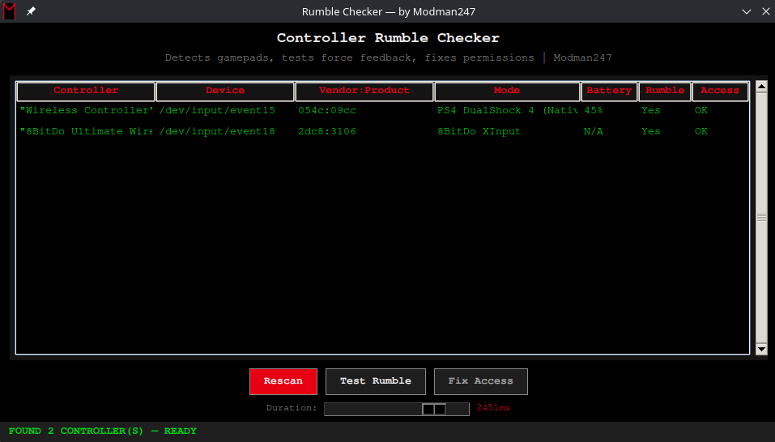

# Rumble Checker

Linux controller diagnostic tool. Detects gamepads, shows vendor:product ID,
tests force feedback, displays controller mode (XInput/DInput/PS4/etc.),
reads battery level, and fixes udev permission issues — all in one GUI.

   

## Requirements

- `python-evdev` (`sudo pacman -S python-evdev`)

## Install

### Arch Linux (AUR)
```bash
yay -S rumble-checker

Manual
sudo pacman -S python-evdev
wget https://github.com/Modman247/rumble-checker/releases/download/v1.0.0/rumble-checker
chmod +x rumble-checker && ./rumble-checker

Features

Detects all connected gamepads
Shows vendor:product ID, controller mode, battery level
Tests rumble with adjustable duration
Fixes udev permissions (adds input group, writes rules by vendor:product)
Works with 8BitDo, Xbox, PlayStation controllers

Modes Detected

Mode	                        Driver
XInput                        (Xbox 360/One)	xpad
HID / DirectInput (Native)	  hid-generic
PlayStation (DS4/DualSense)	  hid-playstation
Steam Input	                  hid-steam

8BitDo Modes

Button Combo	     Mode	      Vendor:Product
SHARE + UP	       XInput	    2dc8:3106
SHARE + LEFT	     DInput     (Native) 2dc8:3105
SHARE + RIGHT	     Mac	      054c:05c4
SHARE + DOWN	     PSC	      054c:0cda
SHARE + UP + LEFT	 Genesis	  0079:0011

Made by Modman247
