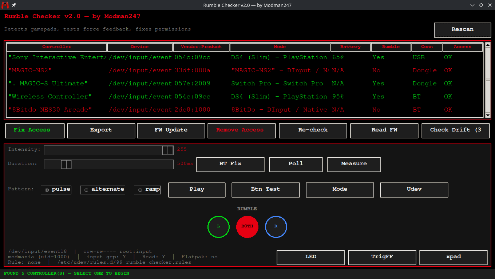

# Rumble Checker v2.0

No existing Linux tool combines rumble, polling, drift, and permission management in one place. This does.

> **v1** was a single-file rumble tester. **v2** is a full diagnostic suite. See [v1.0](https://github.com/Modman247/rumble-checker/tree/v1.0) for the original.

[]()
[]()
[]()

## Screenshot



## Features

**Diagnostics** — polling rate (USB descriptor parse), measured events/s, drift detection, connection type (USB/Dongle/BT), battery, FF support

**Rumble** — L / R / Both, intensity + duration sliders, pulse / alternate / ramp patterns, button test

**Permissions** — Fix / Remove Access (single pkexec prompt), real-time Re-check (no relogin needed)

**System** — Steam conflict detection, fuser, kernel module list, firmware read / update (8BitDo)

**Output** — 15-section export report, CLI JSON, controller database (24 entries)

## Install

### Dependencies

```bash
sudo pacman -S python-evdev          # Arch
sudo apt install python3-evdev       # Debian/Ubuntu

Option 1: install.sh
git clone https://github.com/Modman247/rumble-checker.git
cd rumble-checker
./install.sh

Option 2: makepkg (Arch)
git clone https://github.com/Modman247/rumble-checker.git
cd rumble-checker
makepkg -si

Option 3: Run directly (no install)
git clone https://github.com/Modman247/rumble-checker.git
cd rumble-checker
python3 tk_app.py

No build step required. No root needed after first Fix Access.

Usage
Connect a controller (USB, dongle, or Bluetooth)
Run rumble-checker (or python3 tk_app.py)
Select a controller
Use the action buttons (Drift, FW, Export, Fix/Remove Access, Re-check)
Rumble panel: set intensity / duration / pattern → hit L / BOTH / R
CLI
rumble-checker-cli report    # JSON to stdout

Architecture
File	Purpose
tk_app.py	GUI (Tkinter), popups, rumble thread
backend.py	Detection, evdev, sysfs, udev, pkexec, export
cli.py	CLI (JSON report)
sfx.py	Sound effects
controllers.json	VID:PID database (24 entries)

Dependencies
Python 3.10+
python-evdev (required)
python-dbus (optional)
Known Limitations
DS4 firmware / LED: USB only (BT is firmware-managed)
8BitDo: no battery via any path (firmware limitation)
xpad inject: blocked on kernel 7.2+ (new_id removed)
TrigFF: requires Xbox Series X/S (not yet tested)
Issues
File issues on GitHub.

License
MIT
